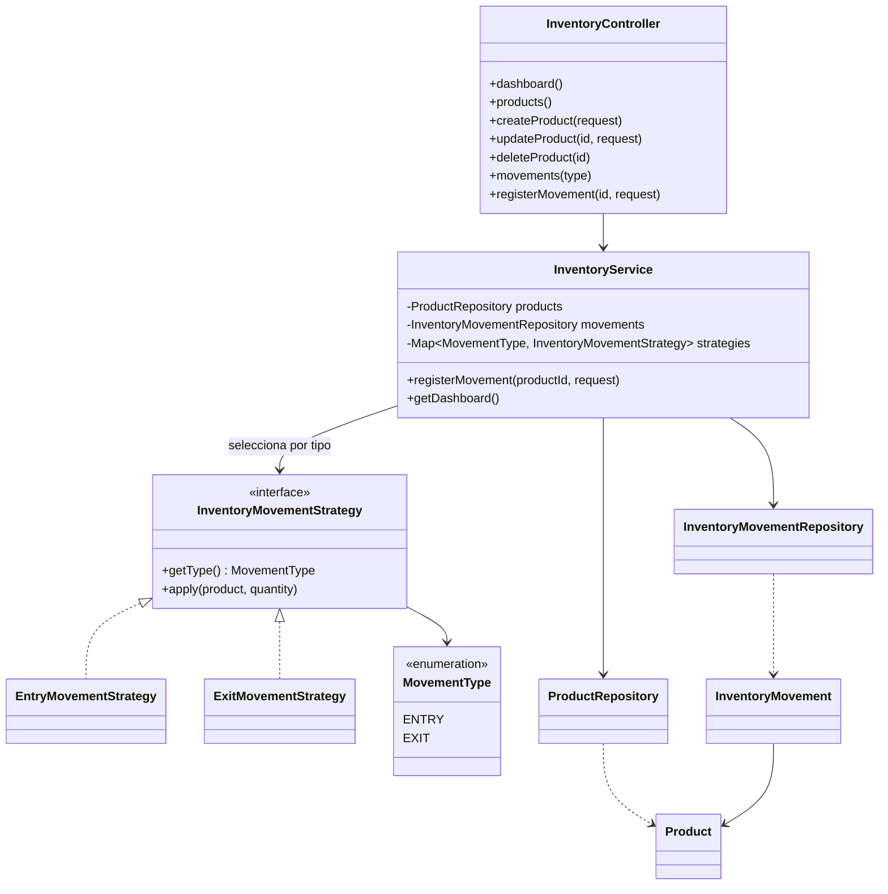
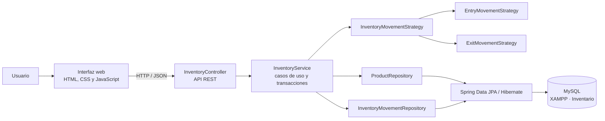

# Diseño de NexoStock

## Patrón GoF seleccionado: Strategy (Estrategia)

Strategy es un patrón de comportamiento GoF que define una familia de algoritmos, encapsula cada uno y permite intercambiarlos sin modificar el objeto que los utiliza. NexoStock lo aplica a la actualización de existencias: `EntryMovementStrategy` suma unidades y `ExitMovementStrategy` valida y descuenta las unidades solicitadas. Ambas implementan `InventoryMovementStrategy`; `InventoryService` selecciona la implementación mediante `MovementType`.

La regla de salida rechaza una cantidad superior al stock disponible. El producto se lee con bloqueo de escritura y el cambio de existencias junto con el registro del movimiento se guardan en una única transacción. Si una regla falla, no se conserva ninguna modificación parcial.

## Diseño de clases

## Arquitectura

## Modelo de datos

- `products`: SKU único, nombre, categoría, descripción, precio unitario COP, existencias y umbral de stock bajo.
- `inventory_movements`: producto relacionado, tipo `ENTRY`/`EXIT`, cantidad, precio unitario al momento de registrar, nota y fecha.
- La llave foránea restringe la eliminación de productos con movimientos, conservando el historial.

## API principal

| Método | Ruta | Función |
| --- | --- | --- |
| `GET` | `/api/dashboard` | Indicadores, alertas y movimientos recientes. |
| `GET` | `/api/products` | Catálogo de artículos. |
| `POST` | `/api/products` | Crear artículo. |
| `PUT` | `/api/products/{id}` | Actualizar datos del artículo. |
| `DELETE` | `/api/products/{id}` | Eliminar artículo sin historial. |
| `GET` | `/api/movements?type=ENTRY` | Consultar movimientos; filtro opcional `ENTRY`/`EXIT`. |
| `GET` | `/api/products/{id}/movements` | Historial de un artículo. |
| `POST` | `/api/products/{id}/movements` | Registrar una entrada o salida. |

El endpoint de movimiento recibe `{"type":"ENTRY","quantity":4,"note":"Reposición"}` o `{"type":"EXIT","quantity":2,"note":"Despacho"}`. Una salida sin existencias suficientes devuelve HTTP `409`; los datos inválidos devuelven `400` y los artículos inexistentes `404`.
